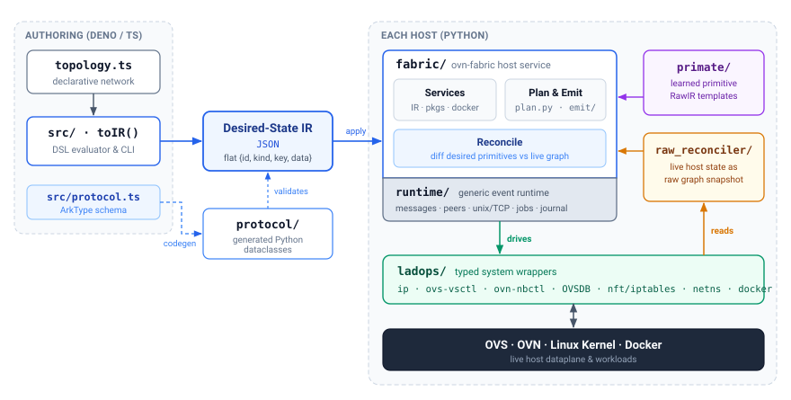

# Architecture

1. **The DSL** (`src/`) evaluates a topology into a network definition, and
   `toIR()` turns that into the **desired-state IR**: a flat set of
   `{id, kind, key, data}` nodes (`infra.host`, `ovn.ls`, `ovn.lr`,
   `ovn.lrp`, `kernel.router`, `security.group`, routes, workloads, …).
   The IR's schema lives in `src/protocol.ts` (ArkType).
2. **The protocol** (`protocol/`) is the same schema as Python dataclasses,
   generated from `src/protocol.ts`. The Python side only ever reads typed
   nodes, so a shape mismatch fails when the IR is loaded, not halfway
   through a deploy.
3. **The runtime** (`runtime/`) is a generic event runtime: messages,
   peers, transports (unix socket, TCP), jobs and a journal. It knows
   nothing about networks.
4. **fabric** (`fabric/`) is ovn-fabric on top of the runtime: services for
   IRs, packages, docker and applying. An apply **plans** the IR into units of
   typed primitives (`fabric/emit/`, `fabric/plan.py`), compares them with
   the live state, and runs what is needed.
5. **ladops** (`ladops/`) wraps the tools the runtime drives and reads:
   `ip`, `ovs-vsctl`, `ovn-nbctl`, OVSDB, `nft`/`iptables`, netns, docker.
6. **raw_reconciler** and **primate** collect the live host state as a raw
   graph, and learn on a real system what each primitive does to it.

## Repository layout

| directory | contents |
| --- | --- |
| `src/` | the TypeScript DSL and the `ovn-fabric` CLI (`generate`, `generate-ir`, `serve-graph`, `generate-pytypes`) |
| `src/types/` | the shapes a topology declares |
| `src/ir/` | `toIR()`, split by node kind |
| `protocol/` | generated Python dataclasses for the IR and the raw snapshot |
| `runtime/` | the generic event runtime |
| `fabric/` | the host service: services, planning, primitives, host-OS discovery, bundle and deploy, CLI |
| `ladops/` | typed wrappers around Linux networking, OVS, OVN, OVSDB, nftables/iptables, docker |
| `raw_reconciler/` | live host state as a raw graph snapshot |
| `primate/` | learns primitive templates from a real system |
| `scripts/` | deploy, install, check, and QEMU/cloud-init/Proxmox test helpers |
| `examples/` | the minimal topology, the living cluster-tenants example, a hand-wired OVS cluster |
| `docs/adr/` | the architecture decision records |

## Decision records

| ADR | |
| --- | --- |
| [0002](https://github.com/mabels/ovn-fabric/blob/main/docs/adr/0002-intermediate-representation.md) | Flat intermediate representation for reconciliation |
| [0003](https://github.com/mabels/ovn-fabric/blob/main/docs/adr/0003-multi-chassis-ovn-cluster.md) | `defineNetwork` as one OVN cluster, not one host |
| [0004](https://github.com/mabels/ovn-fabric/blob/main/docs/adr/0004-userspace-datapath-and-container-ports.md) | Userspace datapath (DPDK / AF_XDP) and container-facing ports |
| [0005](https://github.com/mabels/ovn-fabric/blob/main/docs/adr/0005-xdp-dsl-shape.md) | XDP in the topology DSL: `xdp` interfaces and VLAN parents |
| [0006](https://github.com/mabels/ovn-fabric/blob/main/docs/adr/0006-plan-driven-reconciliation.md) | Plan-driven reconciliation from raw inventory vs desired IR |
| [0007](https://github.com/mabels/ovn-fabric/blob/main/docs/adr/0007-one-host-service-on-an-event-runtime.md) | One host service on an event runtime |
| [0008](https://github.com/mabels/ovn-fabric/blob/main/docs/adr/0008-primitive-rawir-templates-learned-on-a-real-system.md) | Primitive → RawIR templates, learned on a real system |
| [0009](https://github.com/mabels/ovn-fabric/blob/main/docs/adr/0009-tenants-and-switchable-wans.md) | Tenants, gateways, wans |
| [0010](https://github.com/mabels/ovn-fabric/blob/main/docs/adr/0010-natural-keys-for-single-resources.md) | Natural keys: recognising a single resource under a new name |
| [0011](https://github.com/mabels/ovn-fabric/blob/main/docs/adr/0011-logical-addresses-in-the-ir.md) | Logical addresses in the IR: the runtime allocates |
| [0012](https://github.com/mabels/ovn-fabric/blob/main/docs/adr/0012-runtime-deploy-and-background-workloads.md) | Deploying the runtime, and a run that does not wait for docker |
